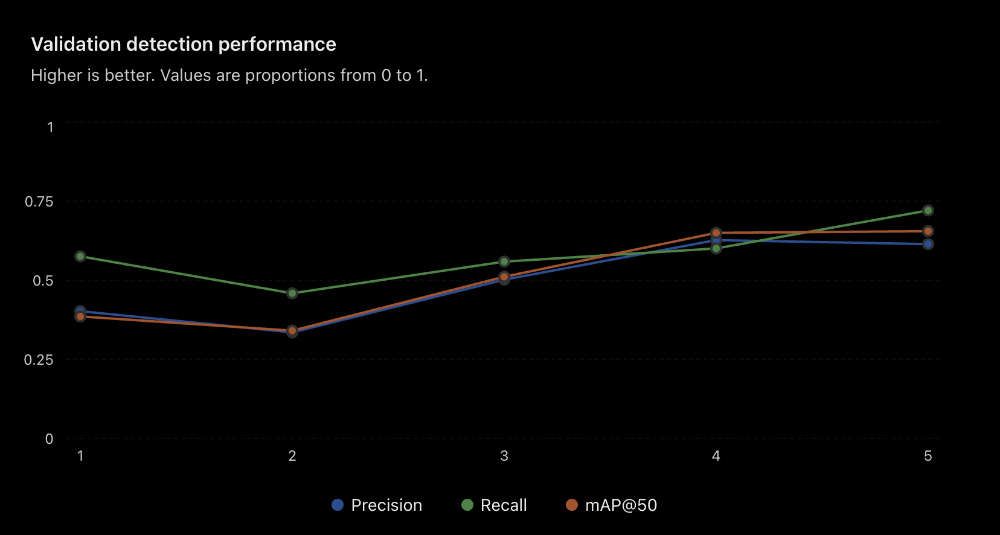

# Methodology

## 1. How to run it

Install Necessary Packages:
```bash
pip install -r requirements.txt
```
Download Dataset:
```bash
python download.py
```
- Note - You will need a Roboflow API key stored in a .env file

Train Model:
```bash
python train.py
```

Run predictions on a folder of images.
Predictions: (requires two arguements)
```bash
python predictions.py <input_folder> <output_folder>
```
The predictions will be saved as .txt files for every image in the folder
Each detection includes class ID, normalized box coodrinates for the boundary, and confidence score 

## 2. Thought process

Setting Up:
- Since this was my first time using the YOLO alogrithm, the first thing I did was read and understand the capabilities of the model using the description doc that came up when I searched on Google. Thenn I worked to set it up on my environment in VScode. I used AI to help me understand the important parameters when ti comes to training and testing the model.

Training:
- For the first test, I trained the model for only 5 epochs.

| Metric | Result |
|---|---:|
| Precision | 62.8% |
| Recall | 59.8% |
| mAP@50 | 65.0% |
| mAP@50–95 | 33.0% |

- I noticed there was gradual improvement across the 5 epochs. I used AI for a visualization of the data:


- The model also seemed better at detecting mallets than bottles in the images:

| Bottle | Mallet |	
|---|---:|
| Precision | 61.3% | 64.3% |
| Recall | 54.6% | 65.1% |
| mAP@50 | 59.5% | 70.4% |

- Now that I knew the model was able to train properly, I increased the epoch size to 30.
Results:

| Metric | Result |
|---|---:|
| Precision | 81.11% |
| Recall | 79.49% |
| mAP@50 | 82.86% |
| mAP@50–95 | 50.22% |

- I saw that the metrics definitely improved compared to the 5 epoch training. I decided to manually go through the prediction image reaults, seeing what factors of the images were commonly causing a wrong detection or no detection at all.

What I noticed:
- usually missed very small or very enlarged objects, or if there were multiple near each other
- many times created multiple boxes over an object (duplicate detection)
- incorrectly detected background objects that weren't bottles or mallets
- the model was only able to detect an object in 193/199 images and didnt create a txt file for every image

My Approach to improving it:
- So first, to fix the last bullet point, I used a for and if loop to create an empty .txt file if no objects were detected in order to meet the project requirements.

- Then to try and decrease some inaccuracies, I was trying to figure out which parameter I can change during training to help. Looking at the first bullet point as it was a pattern I saw a lot throughout the images, I chose to increase the scale augmentation to 0.7 from 0.5
- The model sees much more variation in object sizes while it trains, to hopefully improve its detecting skills for really small or really big objects
- Since this was hopefully going to be my final training run, I also thought to increase the epoch size to also help imrpove model accuracy, while also being afraid of overfitting so I added the patience paramter as well.

Final Training Results:

| Metric | 30 Epochs | Final Model |
|---|---:|---:|
| Precision | 81.11% | 83.6% |
| Recall | 79.49% | 82.3% |
| mAP@50 | 82.86% | 87.2% |
| mAP@50–95 | 50.22% | 54.2% |

- Compared to the last training run, all four of the metrics improved, even among each class--bottle anad mallet

| Metric | Bottle | Mallet |
|---|---:|---:|
| Precision | 82.0% | 85.1% |
| Recall | 78.7% | 85.8% |
| mAP@50 | 81.0% | 93.3% |
| mAP@50–95 | 48.8% | 59.5% |


- However. the model was still better at detecting mallets, which I think could be due to the fact the mallet images were a bit more consistent than the bottle images. A lot of the mallets in the images seemed to be the same bright orange color, while the bottles were all mostly different colors.

 - Now the model wasn’t able to detect an object in only one image. (198/199) 

 - One image with several small bottles previously had no detections, but the new model was able to detect one of them. The model also detected a bottle in a messy outdoor background that it had previously missed. But, even though it was able to detect many more objects, not all were actually correct -> One mallet that was previously missed was now detected as a bottle instead.

 - Finally, attempting to target the bullet point on duplicate detections, I thought to increase the confidence threshold to 0.35. This did help filter out some incorrect predictions. However, some correct ones also disappeared, so I decided to leave the threshold at 0.25.

 - Something extra I also had to fix was for the requirement to have an input and output folder as arguements, I had originally designed it to take in user input after being prompted, but was recommended by AI to use the module argparse because it more closely aligned witht he requirements. I had to learn more about this and its capabilities as well as I had never used it before either.

## 3. Known limitations
I once again looked thrugh the predictions to find out what some inaccuracies were in the model.

- False Positives: I still noticed many random objects in the background being falsely identified.
- False Negatives: The model wasn't always able to detect every object in the image.
- Many images still had the duplicate detections because I wasn't able to find a solution for it using the confidence threshold.
- As a I mentioned before about the consistency of the mallet, I'm not sure if the model will be as accurate with different types/colors of mallets.
- Even though I attempted to minimize it, the model still sometimes failed to detect when there were many small objects close together.
- Regarding my augmentation, I'm not sure if the scale is what improved the metrics or the epoch size increase did. I probably should have made those two changes separately, but since training was taking a while, I chose to combine them.

I think what I'd do next would be trying more augmentation strategies by experiementing, or even adding to the image dataset with more examples of small objects overlapping or partially obscured, as well as more images with different looking mallets.

